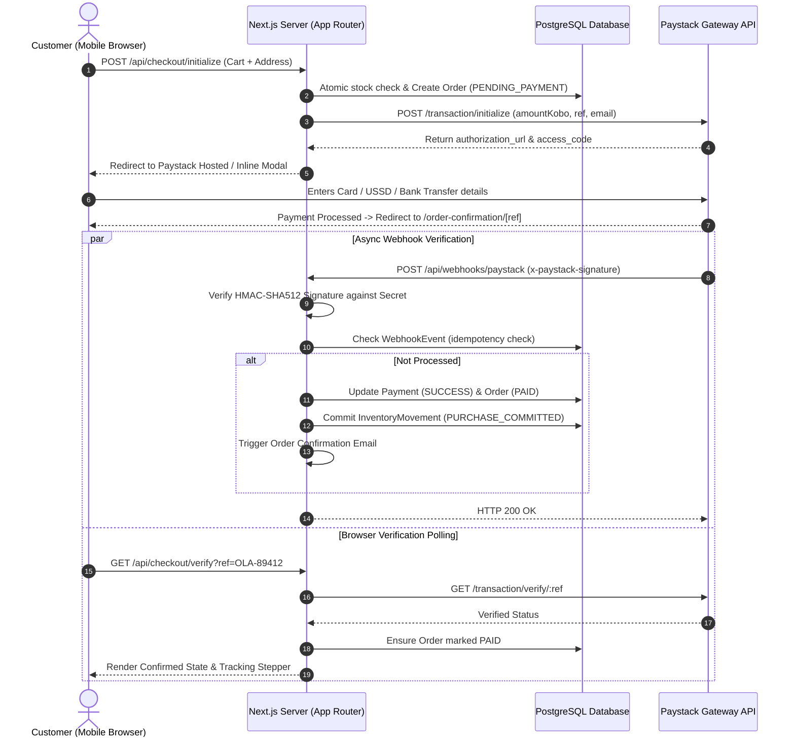

# Ola Shoes — Comprehensive Engineering Implementation Plan

**Author:** Technical Architecture & Lead Engineering Team  
**Date:** October 12, 2026  
**Document Version:** 1.0.0  
**Target Platform:** Mobile-First Luxury E-Commerce Web Application  
**Primary Market:** Nigeria (NGN — ₦)  
**Reference Specification:** [Ola_Shoes_Master_Roadmap.md](file:///c:/Users/T14/Documents/ola%20shoes/Ola_Shoes_Master_Roadmap.md)  
**Design Reference:** [Stitch Mobile Storefront Deliverables](file:///c:/Users/T14/Documents/ola%20shoes/stitch_ola_shoes_mobile_storefront/warm_artisanal_luxury/DESIGN.md)  

---

## Table of Contents
1. [Executive Summary & Architectural Mission](#1-executive-summary--architectural-mission)
2. [Repository & Runtime Environment Audit](#2-repository--runtime-environment-audit)
3. [Stitch Deliverables & Screen Inventory Audit](#3-stitch-deliverables--screen-inventory-audit)
4. [Design System & Visual Identity Specification](#4-design-system--visual-identity-specification)
5. [Application Architecture & Directory Structure](#5-application-architecture--directory-structure)
6. [Data Architecture & Proposed Prisma Schema](#6-data-architecture--proposed-prisma-schema)
7. [Complete Route Inventory & UI States Matrix](#7-complete-route-inventory--ui-states-matrix)
8. [Core Business Workflows & State Machines](#8-core-business-workflows--state-machines)
9. [Administrative Dashboard Specification](#9-administrative-dashboard-specification)
10. [Security, Performance & SEO Blueprint](#10-security-performance--seo-blueprint)
11. [Phased Implementation Roadmap (Phase 0 to Phase 14)](#11-phased-implementation-roadmap-phase-0-to-phase-14)
12. [Business Decisions, Secrets & Dependencies Checklist](#12-business-decisions-secrets--dependencies-checklist)

---

## 1. Executive Summary & Architectural Mission

Ola Shoes is a direct-to-consumer (D2C) luxury footwear brand originating in Lagos, Nigeria. The brand embodies "Warm Artisanal Luxury" — marrying bespoke cordwainer heritage with a sleek, frictionless mobile-first shopping experience.

This implementation plan translates the approved Stitch design deliverables and the Master Product Roadmap into an executable, phased engineering strategy. The goal is not merely to construct visual mockups or static prototypes, but to build a robust, scalable, and secure production commerce system featuring:
- A high-converting, responsive mobile storefront (360px–428px touch ergonomics).
- An end-to-end commerce engine: database-backed variant stock management, atomic inventory reservation, server-recalculated carts, and address-based shipping.
- Hardened Paystack payment integration with cryptographic webhook validation and idempotent state transitions.
- A full-featured, role-protected administrative dashboard for catalogue, order, inventory, customer, and discount management.
- Complete operational readiness: structured logging, database backups, SEO structured data, and automated test coverage.

---

## 2. Repository & Runtime Environment Audit

An inspection of the workspace root (`c:\Users\T14\Documents\ola shoes`) was performed to evaluate tools, runtimes, dependencies, and file structures.

### 2.1 Workspace Findings
1. **Existing Files:**
   - [Ola_Shoes_Master_Roadmap.md](file:///c:/Users/T14/Documents/ola%20shoes/Ola_Shoes_Master_Roadmap.md) (58,595 bytes) — Comprehensive product & technical roadmap.
   - `stitch_ola_shoes_mobile_storefront (1).zip` (4,248,310 bytes) — Raw Stitch archive.
   - `stitch_ola_shoes_mobile_storefront/` — Extracted archive containing 13 screen folders and design documentation.
2. **Runtime Environment:**
   - **Operating System:** Windows 11 / PowerShell environment.
   - **Node.js:** `v24.21.0` (Active LTS / Modern Node runtime installed).
   - **Package Manager:** `npm 11.19.0` (Available via `npm.cmd` and `npx.cmd`).
   - **PowerShell Execution Policy Constraint:** PowerShell restricts execution of `.ps1` wrapper scripts (`npm.ps1`). All CLI actions must explicitly invoke `npm.cmd` or `npx.cmd` to run without security policy blockages.
   - **Git Version Control:** `git` is currently not detected in the Windows system `PATH`. Git initialization and local version control should be established before major refactoring.
3. **Application Skeleton:**
   - No pre-existing Next.js or package repository existed in the root. The project starts from a clean foundation, allowing clean architectural alignment with Next.js App Router, TypeScript, Tailwind CSS, and Prisma ORM.

---

## 3. Stitch Deliverables & Screen Inventory Audit

The extracted Stitch deliverables provide high-fidelity visual and structural references for customer-facing touchpoints.

### 3.1 Supplied Screens & Route Mapping

| # | Stitch Folder | Primary Artifacts | Target Application Route | Component / Functionality Scope |
|---|---------------|-------------------|--------------------------|---------------------------------|
| 01 | `01._homepage` | `code.html`, `screen.png` | `/` | Announcement banner, editorial hero with overlay CTA, curated category cards (Men, Women, Sneakers, Formal), craft ribbon, "Just Landed" carousel/grid, footer links. |
| 02 | `02._shop_all` | `code.html`, `screen.png` | `/shop` | Sticky search/filter bar, horizontal category filter chips, 2-column product grid with badges (NEW, SALE), wishlist toggle, craft story banner, pagination trigger. |
| 03 | `03._category_listing` | `code.html`, `screen.png` | `/category/[slug]` | Dynamic category banner, collection description, multi-attribute filter drawers (size, color, price range), 2-column catalog grid. |
| 04 | `04._search_results` | `code.html`, `screen.png` | `/search?q=...` | Live search input with debouncing, query match count, active filter chips, 2-column matching products, empty state fallback. |
| 05 | `05._product_details` | `code.html`, `screen.png` | `/products/[slug]` | Multi-angle studio gallery thumbnails, price display with VAT notice, interactive color swatches, EU size selector grid (40–45), size guide modal drawer, bespoke craft assurances, sticky "Add to Bag" action bar. |
| 06 | `06._shopping_cart` | `code.html`, `screen.png` | `/cart` | Item line-cards with thumbnail, variant badge, quantity stepper increment/decrement, remove action, packaging delight card, price breakdown stack, checkout CTA. |
| 07 | `07._checkout` | `code.html`, `screen.png` | `/checkout` | Stepper header, contact info inputs (Email, Phone), Nigerian delivery address (State/LGA selection), shipping method radio group (Standard vs Express), collapsible order summary, Paystack payment trigger. |
| 08 | `08._order_confirmation` | `code.html`, `screen.png` | `/order-confirmation/[orderReference]` | Verified order success banner, reference code, purchased item summary, total paid, estimated delivery badge, haptic confetti trigger, tracking CTA. |
| 09 | `09._customer_sign_in` | `code.html`, `screen.png` | `/sign-in` | Email/password fields, password visibility toggle, "Remember me" checkbox, password reset link, social auth triggers (Google/Apple), registration redirect. |
| 10 | `10._create_account` | `code.html`, `screen.png` | `/create-account` | Full name, email, phone number, password strength validation, marketing consent checkbox, terms acceptance, submit CTA. |
| 11 | `11._forgot_password` | `code.html`, `screen.png` | `/forgot-password` | Single-field email recovery input, security notice, back-to-login navigation, recovery status dispatch. |
| 12 | *MISSING IN ZIP* | *None* | `/account` | **Gap Identified:** Screen 12 (`My Account`) was omitted in the ZIP package. Must be synthesized using the design tokens from `13._order_details_tracking` and `09._customer_sign_in`. |
| 13 | `13._order_details_tracking` | `code.html`, `screen.png` | `/account/orders/[orderReference]` | 4-stage tracking stepper (Confirmed, Processing, Shipped, Delivered), shipping address card, item snapshot list, Paystack payment method badge, customer assistance action. |
| 14 | `14._help_contact_policies` | `code.html`, `screen.png` | `/help` | Searchable FAQs, support online status badge, direct phone and email links, Lagos atelier address with map trigger, policy navigation links. |

### 3.2 Critical Gaps Identified in Stitch Deliverables
1. **Missing Customer Account Dashboard (Screen 12):** The ZIP sequence jumps from `11._forgot_password` to `13._order_details_tracking`. We will build a unified `/account` portal with sub-views: `/account/profile`, `/account/orders`, `/account/addresses`, and `/account/saved`.
2. **Hardcoded Mock Data:** All screens feature static HTML and inline prices (e.g., `₦68,000`), hardcoded customer names (`John Doe`), and static image URLs hosted on external Google user-content mirrors.
3. **No Administrative Screens:** The Stitch deliverable covers only customer-facing mobile interfaces. Admin management screens (products, variants, inventory, orders, discount coupons, store settings) must be designed using the same aesthetic tokens.
4. **Desktop & Tablet Responsiveness:** Stitch screens are locked strictly to mobile shells (`shell-type="mobile_tab"`). The production application will preserve mobile layout perfection while cleanly centering or scaling gracefully on desktop viewports without distortion.

---

## 4. Design System & Visual Identity Specification

The design system is documented in `stitch_ola_shoes_mobile_storefront/warm_artisanal_luxury/DESIGN.md`. It establishes an editorial aesthetic described as **Warm Artisanal Luxury**.

### 4.1 Reconciled Color Palette & CSS Variables
The design tokens avoid sterile blacks and blues in favor of sun-drenched ivory, tanned hide, and deep espresso tones:

```css
:root {
  /* Surfaces & Canvas */
  --color-surface: #FAF7F2;               /* Warm Alabaster / Cream Canvas */
  --color-surface-dim: #DCDAD5;
  --color-surface-low: #F6F3EE;           /* Secondary card backdrop */
  --color-surface-container: #F0EDE9;     /* Filter chip & input fills */
  --color-surface-high: #EBE8E3;
  --color-surface-highest: #E5E2DD;
  --color-surface-white: #FFFFFF;         /* Crisp card inset */

  /* Text & Contrast */
  --color-on-surface: #1C1917;            /* Deep Warm Charcoal (Primary Text) */
  --color-on-surface-variant: #4E4540;    /* Muted secondary body */
  --color-outline: #807570;               /* Subdued borders & inactive icons */
  --color-outline-variant: #D2C4BE;       /* Hairline dividers */

  /* Brand Accents & Actions */
  --color-primary: #231812;               /* Deep Espresso Brown (Primary CTA) */
  --color-on-primary: #FFFFFF;
  --color-primary-container: #241913;     /* Dark brand banners & header logo */
  --color-accent-leather: #9E7151;        /* Warm Tan / Leather Sienna (Badges & active swatches) */
  --color-secondary-container: #E6DFD5;   /* Craft ribbon fill */
  --color-on-secondary-fixed: #1E1B15;

  /* Feedback & Validation */
  --color-error: #BA1A1A;                 /* Crimson / Sale tag */
  --color-error-container: #FFDAD6;
  --color-success: #1E6B37;               /* Order confirmed / verified badge */
}
```

### 4.2 Typography Pairing
- **Editorial Headings & Brand Moments:** `Playfair Display` (Weights: 500, 600, 700). Applied to collection headers, hero banners, and milestone cards.
- **Interface, Specs, Forms & Prices:** `Plus Jakarta Sans` (Weights: 400, 500, 600, 700). Applied to buttons, sizes, inputs, metadata, and Nigerian Naira currency figures (`₦58,000`).
- **Iconography:** Fine-line Google Material Symbols (`rounded`, weight 300, fill 0/1) paired with Lucide React icons for application UI controls.

### 4.3 Mobile-First Ergonomics
- **Base Viewport Target:** 360px to 428px width, with adaptive desktop centering max-width container (`max-w-md mx-auto min-h-screen shadow-2xl`).
- **Touch Boundaries:** All interactive buttons and chips maintain a minimum touch bounding box of 44px × 44px.
- **Fixed Bars & Safe Areas:** 
  - Sticky top header: 56px height + `env(safe-area-inset-top)`.
  - Persistent bottom navigation: 64px height + `env(safe-area-inset-bottom)`.
  - Sticky checkout / Add-to-Cart drawer: Elevated above bottom navigation with diffused warm shadow: `box-shadow: 0px -4px 20px rgba(35, 24, 18, 0.05)`.

---

## 5. Application Architecture & Directory Structure

To maintain clean separation between presentation, domain rules, and data persistence, Ola Shoes will be organized as a **Modular Monolith** using Next.js 15+ App Router and TypeScript.

```
ola-shoes/
├── app/                                 # Next.js App Router
│   ├── (storefront)/                    # Customer-facing shopping routes
│   │   ├── page.tsx                     # Homepage (Screen 01)
│   │   ├── shop/page.tsx                # Catalog / Shop All (Screen 02)
│   │   ├── category/[slug]/page.tsx     # Category View (Screen 03)
│   │   ├── search/page.tsx              # Search Results (Screen 04)
│   │   ├── products/[slug]/page.tsx     # Product Details (Screen 05)
│   │   ├── cart/page.tsx                # Shopping Cart (Screen 06)
│   │   ├── checkout/page.tsx            # Checkout & Shipping (Screen 07)
│   │   ├── order-confirmation/[ref]/    # Confirmation (Screen 08)
│   │   ├── saved/page.tsx               # Wishlist / Saved Items
│   │   ├── help/page.tsx                # FAQs & Support (Screen 14)
│   │   ├── track-order/page.tsx         # Public Order Lookup
│   │   └── policies/                    # Shipping, Returns, Privacy, Terms
│   ├── (auth)/                          # Customer authentication routes
│   │   ├── sign-in/page.tsx             # Sign In (Screen 09)
│   │   ├── create-account/page.tsx      # Register (Screen 10)
│   │   ├── forgot-password/page.tsx     # Password Request (Screen 11)
│   │   └── reset-password/page.tsx      # Password Reset Execution
│   ├── (account)/                       # Authenticated customer portal
│   │   ├── account/page.tsx             # Account Overview (Screen 12 Synthesis)
│   │   ├── account/orders/page.tsx      # Order History
│   │   ├── account/orders/[ref]/        # Detailed Tracking (Screen 13)
│   │   ├── account/addresses/page.tsx   # Saved Shipping Addresses
│   │   └── account/security/page.tsx    # Password & Profile Settings
│   ├── (admin)/admin/                   # Protected administrative back-office
│   │   ├── layout.tsx                   # Admin sidebar / responsive shell
│   │   ├── login/page.tsx               # Dedicated staff login
│   │   ├── dashboard/page.tsx           # Metrics, revenue, low stock
│   │   ├── products/                    # Product listing & editor
│   │   │   ├── page.tsx                 # Products table & filters
│   │   │   └── [id]/page.tsx            # Multi-variant editor & gallery
│   │   ├── inventory/page.tsx           # Stock ledger & manual adjustments
│   │   ├── orders/                      # Orders management
│   │   │   ├── page.tsx                 # Order filter list
│   │   │   └── [ref]/page.tsx           # Fulfilment status & refund controls
│   │   ├── customers/page.tsx           # Customer profiles & purchase history
│   │   ├── promotions/page.tsx          # Coupon codes & campaign limits
│   │   └── settings/page.tsx            # Delivery fees, VAT, store identity
│   ├── api/                             # Route handlers & webhooks
│   │   ├── webhooks/paystack/route.ts   # Cryptographic Paystack Webhook
│   │   ├── catalogue/search/route.ts    # Debounced live search endpoint
│   │   └── checkout/verify/route.ts     # Client return verification callback
│   ├── layout.tsx                       # Root layout with fonts & providers
│   ├── not-found.tsx                    # Branded 404 screen
│   └── error.tsx                        # Global recoverable error boundary
├── components/                          # Reusable UI component library
│   ├── layout/                          # Header, Footer, BottomNav, AnnouncementBar
│   ├── catalogue/                       # ProductCard, Gallery, SizeSelector, ColorChips
│   ├── cart/                            # CartItemRow, Stepper, PriceSummary
│   ├── checkout/                        # AddressForm, ShippingMethodPicker, PaystackTrigger
│   ├── admin/                           # DataTable, MetricCard, ImageUploader, StatusBadge
│   └── ui/                              # Button, Input, Modal, Drawer, Toast, Skeleton
├── lib/                                 # Shared infrastructure & utilities
│   ├── db.ts                            # Prisma Client singleton
│   ├── auth.ts                          # JWT / Session security utilities
│   ├── paystack.ts                      # Paystack API client & signature verifier
│   ├── currency.ts                      # Minor unit (kobo <-> naira) formatting
│   ├── validation.ts                    # Zod schemas for forms and API payloads
│   └── errors.ts                        # Typed domain error classes
├── server/                              # Server-only domain services
│   ├── catalogue.service.ts             # Products, categories, collections queries
│   ├── cart.service.ts                  # Cart validation, cookie persistence
│   ├── inventory.service.ts             # Concurrency-safe stock reservation
│   ├── order.service.ts                 # Order lifecycle & state transitions
│   ├── payment.service.ts               # Paystack transaction initialization & verify
│   ├── shipping.service.ts              # Delivery zone & fee calculation
│   └── audit.service.ts                 # Admin audit log writer
├── prisma/                              # Database schema & migrations
│   ├── schema.prisma                    # PostgreSQL relational model
│   └── seed.ts                          # Idempotent demo catalogue seeder
├── public/                              # Optimized static assets & logos
└── tests/                               # Test suites
    ├── unit/                            # Math, currency, discount calculations
    ├── integration/                     # Stock reservation & order transactions
    └── e2e/                             # Guest checkout & payment journey
```

---

## 6. Data Architecture & Proposed Prisma Schema

The database model is built for PostgreSQL with strict referential integrity. All monetary figures are stored in **integer minor units (kobo: 100 kobo = ₦1.00)** to eliminate floating-point calculation errors.

### 6.1 Relational Schema Specification

```prisma
datasource db {
  provider = "postgresql"
  url      = env("DATABASE_URL")
}

generator client {
  provider = "prisma-client-js"
}

enum Role {
  CUSTOMER
  ADMIN
  STAFF
}

enum ProductStatus {
  DRAFT
  ACTIVE
  ARCHIVED
}

enum OrderStatus {
  PENDING_PAYMENT
  PAID
  PROCESSING
  SHIPPED
  DELIVERED
  CANCELLED
  REFUNDED
}

enum PaymentStatus {
  PENDING
  SUCCESS
  FAILED
  ABANDONED
  REFUNDED
}

enum InventoryChangeReason {
  PURCHASE_COMMITTED
  ORDER_CANCELLED
  MANUAL_ADJUSTMENT
  RESTOCK
  DAMAGE_WRITE_OFF
}

// ==================== USER & ACCESS ====================
model User {
  id            String         @id @default(uuid())
  email         String         @unique
  passwordHash  String?
  firstName     String
  lastName      String
  phone         String?
  role          Role           @default(CUSTOMER)
  createdAt     DateTime       @default(now())
  updatedAt     DateTime       @updatedAt

  addresses     Address[]
  orders        Order[]
  wishlistItems WishlistItem[]
  auditLogs     AuditLog[]
}

model Address {
  id           String   @id @default(uuid())
  userId       String?
  user         User?    @relation(fields: [userId], references: [id], onDelete: Cascade)
  fullName     String
  phoneNumber  String
  street       String
  city         String
  state        String   // e.g. Lagos, Abuja FCT, Rivers
  postalCode   String?
  isDefault    Boolean  @default(false)
  createdAt    DateTime @default(now())

  orders       Order[]
}

// ==================== CATALOGUE & VARIANTS ====================
model Category {
  id          String    @id @default(uuid())
  name        String
  slug        String    @unique
  description String?
  imageUrl    String?
  sortOrder   Int       @default(0)
  products    Product[]
}

model Product {
  id             String           @id @default(uuid())
  name           String
  slug           String           @unique
  skuPrefix      String           @unique
  description    String           @db.Text
  craftStory     String?          @db.Text
  material       String?          // e.g. Full-grain calfskin leather
  categoryId     String
  category       Category         @relation(fields: [categoryId], references: [id])
  status         ProductStatus    @default(ACTIVE)
  basePriceKobo  BigInt           // Authoritative base price
  salePriceKobo  BigInt?          // Optional discounted price
  isNewArrival   Boolean          @default(false)
  isFeatured     Boolean          @default(false)
  createdAt      DateTime         @default(now())
  updatedAt      DateTime         @updatedAt

  images         ProductImage[]
  variants       ProductVariant[]
}

model ProductImage {
  id        String   @id @default(uuid())
  productId String
  product   Product  @relation(fields: [productId], references: [id], onDelete: Cascade)
  url       String
  altText   String
  sortOrder Int      @default(0)
  isCover   Boolean  @default(false)
}

model ProductVariant {
  id             String          @id @default(uuid())
  productId      String
  product        Product         @relation(fields: [productId], references: [id], onDelete: Cascade)
  sku            String          @unique // e.g. OLA-LOAF-BRN-42
  size           String          // EU 40, 41, 42, 43, 44, 45
  colorName      String          // e.g. Dark Brown, Onyx Black
  colorHex       String          // e.g. #3B2219
  priceKobo      BigInt?         // Override price if variant pricing differs
  stockQuantity  Int             @default(0)
  lowStockLimit  Int             @default(3)
  isActive       Boolean         @default(true)

  orderItems     OrderItem[]
  movements      InventoryMovement[]
}

// ==================== INVENTORY MOVEMENTS ====================
model InventoryMovement {
  id            String                @id @default(uuid())
  variantId     String
  variant       ProductVariant        @relation(fields: [variantId], references: [id])
  quantityDelta Int                   // Negative on deduction, positive on restock
  reason        InventoryChangeReason
  referenceNote String?               // e.g. Order #OLA-2026-8941
  actorId       String?               // User ID who performed change
  createdAt     DateTime              @default(now())
}

// ==================== CART & WISHLIST ====================
model Cart {
  id        String     @id @default(uuid())
  sessionId String     @unique // Guest session token or user identifier
  createdAt DateTime   @default(now())
  updatedAt DateTime   @updatedAt
  items     CartItem[]
}

model CartItem {
  id         String   @id @default(uuid())
  cartId     String
  cart       Cart     @relation(fields: [cartId], references: [id], onDelete: Cascade)
  variantId  String
  quantity   Int      @default(1)
  createdAt  DateTime @default(now())
}

model WishlistItem {
  id        String   @id @default(uuid())
  userId    String
  user      User     @relation(fields: [userId], references: [id], onDelete: Cascade)
  productId String
  createdAt DateTime @default(now())

  @@unique([userId, productId])
}

// ==================== PROMOTIONS ====================
model Promotion {
  id              String    @id @default(uuid())
  code            String    @unique
  discountPercent Int?      // e.g. 10 for 10%
  discountKobo    BigInt?   // Fixed discount minor units
  minOrderKobo    BigInt    @default(0)
  maxRedemptions  Int?
  timesRedeemed   Int       @default(0)
  startsAt        DateTime  @default(now())
  expiresAt       DateTime?
  isActive        Boolean   @default(true)

  orders          Order[]
}

// ==================== ORDERS & PAYMENTS ====================
model Order {
  id               String        @id @default(uuid())
  orderReference   String        @unique // e.g. OLA-89412
  userId           String?
  user             User?         @relation(fields: [userId], references: [id])
  guestEmail       String?
  guestPhone       String?
  addressId        String
  address          Address       @relation(fields: [addressId], references: [id])
  
  subtotalKobo     BigInt
  deliveryFeeKobo  BigInt
  discountKobo     BigInt        @default(0)
  totalKobo        BigInt
  currency         String        @default("NGN")

  deliveryMethod   String        // "Standard Express" | "Express Priority"
  orderStatus      OrderStatus   @default(PENDING_PAYMENT)
  paymentStatus    PaymentStatus @default(PENDING)
  trackingNumber   String?
  notes            String?       @db.Text

  promotionId      String?
  promotion        Promotion?    @relation(fields: [promotionId], references: [id])

  createdAt        DateTime      @default(now())
  updatedAt        DateTime      @updatedAt

  items            OrderItem[]
  payments         Payment[]
}

model OrderItem {
  id             String         @id @default(uuid())
  orderId        String
  order          Order          @relation(fields: [orderId], references: [id], onDelete: Cascade)
  variantId      String
  variant        ProductVariant @relation(fields: [variantId], references: [id])
  
  // Historical Snapshots (Immune to catalogue changes)
  productName    String
  variantSku     String
  size           String
  colorName      String
  unitPriceKobo  BigInt
  quantity       Int
  totalKobo      BigInt
}

model Payment {
  id             String        @id @default(uuid())
  orderId        String
  order          Order         @relation(fields: [orderId], references: [id], onDelete: Cascade)
  paystackRef    String        @unique // Paystack transaction reference
  amountKobo     BigInt
  currency       String        @default("NGN")
  status         PaymentStatus @default(PENDING)
  channel        String?       // "card", "bank_transfer", "ussd"
  verifiedAt     DateTime?
  rawResponse    Json?
  createdAt      DateTime      @default(now())
}

model WebhookEvent {
  id         String   @id @default(uuid())
  eventId    String   @unique // Paystack event identifier or hash
  eventType  String
  payload    Json
  processed  Boolean  @default(false)
  receivedAt DateTime @default(now())
}

// ==================== STORE SETTINGS & AUDIT ====================
model StoreSetting {
  id                  String   @id @default(uuid())
  storeName           String   @default("Ola Shoes")
  contactEmail        String   @default("support@olashoes.com")
  contactPhone        String   @default("+234 801 234 5678")
  atelierAddress      String   @default("123 Adeola Odeku Street, Victoria Island, Lagos")
  standardShippingKobo BigInt  @default(250000) // ₦2,500
  expressShippingKobo  BigInt  @default(450000) // ₦4,500
  freeShippingThresholdKobo BigInt @default(10000000) // ₦100,000
  updatedAt           DateTime @updatedAt
}

model AuditLog {
  id         String   @id @default(uuid())
  actorId    String?
  actor      User?    @relation(fields: [actorId], references: [id])
  action     String   // "UPDATE_PRICE", "ADJUST_STOCK", "UPDATE_ORDER_STATUS"
  targetType String   // "PRODUCT", "ORDER", "VARIANT"
  targetId   String
  metadata   Json?
  createdAt  DateTime @default(now())
}
```

---

## 7. Complete Route Inventory & UI States Matrix

A production commerce storefront requires graceful error boundaries, empty states, and feedback notices across every screen.

### 7.1 Customer & Storefront States

| Route | Primary View State | Empty State | Loading Skeleton State | Error / Recoverable State |
|-------|--------------------|-------------|------------------------|---------------------------|
| `/` | Hero, Categories, Just Landed, Craft Ribbon | Banner with default brand story | Pulsing image skeleton blocks | Graceful degradation to cached catalog |
| `/shop` | 2-column shoe grid, filter chips, sort options | "No styles found matching current filters" with "Reset Filters" CTA | 6-card shimmer skeleton grid | Network retry banner |
| `/category/[slug]` | Category header + filtered products | "New collection arriving soon" | Category banner shimmer + cards | 404 Category Not Found redirection |
| `/search` | Live query suggestions & results | "No shoes found for '[query]'" with recommended bestsellers | Instant debounced spinner | Graceful query fallback |
| `/products/[slug]` | Multi-angle carousel, sizes, CTA | N/A (Redirects to catalog if slug archived) | High-res gallery blur-up shimmer | "Size currently out of stock" with disabled Add-to-Bag |
| `/cart` | Item line rows, price summary, checkout CTA | "Your shopping bag is empty" with "Explore Collection" button | Subtotal calculating spinner | "Item stock changed" modal notification |
| `/checkout` | Stepper, contact, delivery, Paystack CTA | N/A (Redirects to `/cart` if bag empty) | Payment initialization loader | "Delivery unavailable in region" or "Payment cancelled" recovery banner |
| `/order-confirmation/[ref]` | Verified checkmark, order breakdown, tracking link | "Order lookup in progress" | Payment verification polling spinner | "Payment unverified — pending confirmation" guidance |
| `/saved` | Wishlist grid with quick move-to-bag | "No saved pairs yet" with heart illustration | Wishlist shimmer grid | Auth prompt for cross-device synchronization |
| `/account` | Orders overview, profile details, quick links | "No previous orders placed" | Account card skeletons | Session timeout notice with seamless re-login |
| `/help` | FAQs accordion, atelier contact, policy links | Filtered search "No matching answers" | Content block skeletons | Direct WhatsApp support escalation |

---

## 8. Core Business Workflows & State Machines

### 8.1 Inventory Concurrency & Reservation Strategy
To prevent overselling during flash promotions or concurrent customer checkouts:
1. **Server-Side Verification:** Client carts never decrement database stock. When the customer clicks **"Continue to Payment"** on `/checkout`, an atomic database transaction runs:
   ```sql
   UPDATE "ProductVariant"
   SET "stockQuantity" = "stockQuantity" - $quantity
   WHERE "id" = $variantId AND "stockQuantity" >= $quantity;
   ```
2. **Atomic Rollback:** If insufficient stock exists for any cart line item, the entire checkout transaction aborts, returning an explicit message: *"Size 42 in Everyday Leather Loafer is no longer available"*.
3. **Reservation Expiry:** A pending order holds a 20-minute reservation window. If payment fails or Paystack reports transaction abandonment, a background reconciliation cron releases the stock back to the active ledger with reason `ORDER_CANCELLED`.

### 8.2 Paystack Payment & Webhook Idempotency Lifecycle



### 8.3 Order Status Lifecycle

```
[ PENDING_PAYMENT ] ──(Customer abandons / Payment fails)──> [ CANCELLED ] (Stock released)
        │
        ▼ (Paystack Signature Verified)
    [ PAID ]
        │
        ▼ (Staff picks & packs in Lagos atelier)
  [ PROCESSING ]
        │
        ▼ (Assigned tracking number & courier dispatch)
   [ SHIPPED ]
        │
        ▼ (Customer confirms receipt)
  [ DELIVERED ]
        │
        ▼ (Customer return within 14-day warranty)
  [ REFUNDED ] (Stock audited & restocked)
```

---

## 9. Administrative Dashboard Specification

The admin interface will be housed under `/admin` and protected by server-enforced role verification (`Role.ADMIN` / `Role.STAFF`).

### 9.1 Required Operational Modules
1. **Overview Analytics (`/admin/dashboard`):**
   - Gross Revenue, Net Orders, Average Order Value (AOV).
   - Low-stock alerts banner (variants with $\le$ 3 units remaining).
   - Recent 10 orders with real-time status pills.
2. **Product & Variant Suite (`/admin/products` & `/admin/products/[id]`):**
   - Product metadata editor (Name, Slug, Material, Description, Craft Story).
   - Variant matrix builder: dynamically add sizes (EU 40–45) and colors (with Hex swatch picker).
   - High-resolution image drag-and-drop uploader with cover-image assignment.
   - Status toggles: Draft, Active, Archived.
3. **Inventory Management Ledger (`/admin/inventory`):**
   - Variant-level stock quantity adjustments.
   - Mandatory audit logging: each change requires an actor and a documented reason (*Restock*, *Damaged Pair*, *Count Correction*).
4. **Order Fulfilment Console (`/admin/orders` & `/admin/orders/[ref]`):**
   - Filter by date, payment status, and fulfilment stage.
   - Customer shipping label details & direct phone contact link.
   - Stage progression button: Mark as *Processing*, *Shipped* (with carrier tracking input), or *Delivered*.
   - Cancellation and refund authorization controls.
5. **Promotions & Coupon Manager (`/admin/promotions`):**
   - Create voucher codes (e.g., `LAGOSLUXURY10`).
   - Define percentage discount or fixed naira deduction, minimum order value, usage limits, and expiration dates.
6. **Storefront Settings (`/admin/settings`):**
   - Delivery fees (Standard vs. Express) and Free Delivery threshold.
   - Store telephone, atelier address, and support email displayed across the customer portal.

---

## 10. Security, Performance & SEO Blueprint

### 10.1 Security Architecture
- **Secret Hygiene:** All Paystack secret keys (`PAYSTACK_SECRET_KEY`), database connection strings (`DATABASE_URL`), and session encryption secrets (`AUTH_SECRET`) are stored strictly in environment variables and never exposed to client bundles.
- **Webhook Authenticity:** Every incoming Paystack webhook payload is hashed using `crypto.createHmac('sha512', secret)` and verified against the `x-paystack-signature` header before executing database changes.
- **Tamper-Proof Calculations:** The client never passes totals or prices. The server re-reads variant prices from PostgreSQL, calculates shipping according to store settings, validates promotions, and dispatches the authoritative amount to Paystack in kobo.
- **SQL & Injection Defense:** Parameterized queries via Prisma ORM eliminate SQL injection risks. Input schemas validated via Zod prevent XSS and malformed payloads.

### 10.2 Performance Optimization
- **Next.js App Router Architecture:** Static catalogue pages rendered as Server Components with incremental cache revalidation (`revalidate = 3600`). Client components used strictly for interactive selectors (swatches, size pills, quantity steppers).
- **Responsive Media:** Next.js `<Image />` component with WebP conversion, exact aspect ratios (`aspect-square`, `aspect-[4/3]`), and lazy loading for below-the-fold catalog grids.
- **Bundle Diet:** Elimination of excessive third-party dependencies, leveraging pure Tailwind CSS utility tokens.

### 10.3 Search Engine Optimization (SEO)
- **Metadata Generation:** Dynamic OpenGraph titles and descriptions for every shoe model (`generateMetadata({ params })`).
- **Structured Schema (JSON-LD):** Product Schema (`schema.org/Product`) injected into `/products/[slug]` containing name, image gallery, SKU, price currency (`NGN`), and in-stock availability.
- **Robots & Sitemap:** Dynamic `sitemap.xml` automatically crawling all active categories and products while strictly disallowing private routes (`/admin/*`, `/account/*`, `/checkout/*`).

---

## 11. Phased Implementation Roadmap (Phase 0 to Phase 14)

Building a complete e-commerce platform requires disciplined, milestone-based execution. Work will proceed chronologically through the following **15 distinct phases (Phase 0 through Phase 14)**.

```
Phase 0 ──> Phase 1 ──> Phase 2 ──> Phase 3 ──> Phase 4
                                                   │
Phase 9 <── Phase 8 <── Phase 7 <── Phase 6 <── Phase 5
   │
Phase 10 ──> Phase 11 ──> Phase 12 ──> Phase 13 ──> Phase 14 [PRODUCTION LAUNCH]
```

---

### Phase 0: Project Inception, Repository Audit & Tooling Setup
- **Objective:** Establish the development environment, package manifest, Next.js configuration, and Git version control.
- **Key Tasks:**
  1. Initialize Next.js 15+ App Router project with TypeScript and ESLint using `npm.cmd` / `npx.cmd`.
  2. Configure `tsconfig.json` with strict type checking and `@/*` path alias mapping.
  3. Set up `.gitignore` to protect `.env`, node modules, build artifacts, and local secrets.
  4. Create `.env.example` documenting all configuration keys.
- **Deliverables:** A working Next.js workspace that compiles cleanly with zero warnings.

---

### Phase 1: Application Foundation & Design System Infrastructure
- **Objective:** Implement the "Warm Artisanal Luxury" design tokens into Tailwind CSS and configure typography and base layouts.
- **Key Tasks:**
  1. Install and configure Tailwind CSS v3/v4 with custom color tokens from `DESIGN.md` (`surface`, `primary-container`, `accent-leather`, etc.).
  2. Configure Google Fonts: `Playfair Display` (editorial serif) and `Plus Jakarta Sans` (interface sans) via `next/font/google`.
  3. Reconcile CSS variables in `app/globals.css`, including mobile safe-area insets (`pt-safe`, `pb-safe`).
  4. Create the base mobile viewport wrapper (`max-w-md mx-auto`) with ambient shadows for preview on desktop.
- **Deliverables:** Reusable typography styles, color palette utility classes, and global CSS tokens ready for component styling.

---

### Phase 2: Design System Component Library
- **Objective:** Build accessible, pixel-accurate UI atoms and composite components matching the Stitch designs.
- **Key Tasks:**
  1. Build navigation atoms: `AnnouncementBar`, `StoreHeader`, and persistent 4-tab `BottomNav`.
  2. Build catalogue components: `ProductCard` (dual-grid), `FavoriteBadge`, and `BadgeTag` (`NEW`, `SALE`).
  3. Build selection controls: `ColorChip`, `SizeSelectorTile`, and `QuantityStepper`.
  4. Build feedback and utility elements: `Button` (espresso primary & ghost), `Drawer`, `Modal`, `PriceSummaryStack`, and loading shimmer `Skeleton` components.
- **Deliverables:** A modular UI component kit in `components/ui/` and `components/catalogue/`.

---

### Phase 3: Public Discovery Storefront
- **Objective:** Construct the customer-facing shopping pages with dynamic mock data faithful to Stitch screens.
- **Key Tasks:**
  1. Assemble **Homepage** (`/`): Editorial hero banner, curated category cards, craft ribbon, and Just Landed feed.
  2. Assemble **Shop All** (`/shop`): Category filter chips, 2-column catalog grid, and load-more trigger.
  3. Assemble **Category Listing** (`/category/[slug]`): Filter drawer and collection headers.
  4. Assemble **Search Results** (`/search`): Real-time debounced query filtering and zero-result fallback.
  5. Assemble **Product Details Page** (`/products/[slug]`): Multi-angle thumbnail gallery, size guide drawer, color switching, and sticky Add-to-Bag bar.
  6. Assemble **Saved Items** (`/saved`): Guest and user wishlist view.
- **Deliverables:** A fully navigable mobile storefront allowing complete visual and interactive browsing.

---

### Phase 4: Database Infrastructure & Catalogue Management
- **Objective:** Deploy PostgreSQL, implement the Prisma schema, and replace development data with real database persistence.
- **Key Tasks:**
  1. Configure Prisma ORM with PostgreSQL connection.
  2. Implement schema models: `Category`, `Product`, `ProductImage`, `ProductVariant`, and `InventoryMovement`.
  3. Generate and run initial Prisma migrations.
  4. Build an idempotent database seed script (`prisma/seed.ts`) populating real Nigerian footwear models (Loafers, Sneakers, Oxfords, Heels, Slides) with realistic NGN pricing and sizes.
  5. Refactor storefront routes (`/`, `/shop`, `/products/[slug]`) to query the database via Server Components.
- **Deliverables:** Live database-driven product catalogue with instant queries and variant relationships.

---

### Phase 5: Cart Engine, Session Management & Stock Validation
- **Objective:** Build a resilient shopping cart supporting guest persistence, variant stock validation, and quantity limits.
- **Key Tasks:**
  1. Implement cart service supporting both HTTP-only cookie guest sessions and authenticated customer profiles.
  2. Build cart operations: Add to cart with specific size/color, quantity increment/decrement, and removal.
  3. Implement server-side stock check: prevent adding out-of-stock sizes or exceeding available inventory.
  4. Create `/cart` page with line item thumbnails, packaging delight notice, and server-recalculated price summary.
  5. Add promotion code input with server-side validation against `Promotion` records.
- **Deliverables:** Fully functioning shopping cart with real-time stock awareness and coupon discounts.

---

### Phase 6: Guest & Authenticated Checkout Engine
- **Objective:** Construct the checkout experience, collecting contact, Nigerian delivery address, and shipping options.
- **Key Tasks:**
  1. Build `/checkout` multi-step form with React Hook Form and Zod validation.
  2. Support seamless guest checkout (collecting Email & WhatsApp phone number without mandatory password creation).
  3. Implement delivery address selector with Nigerian states (Lagos, Abuja FCT, Rivers, Oyo, etc.).
  4. Build dynamic delivery fee engine: Standard (₦2,500) vs. Express (₦4,500) with automatic complimentary delivery for orders over ₦100,000.
  5. Implement duplicate submission prevention (idempotency tokens and disabled double-click buttons).
- **Deliverables:** Complete checkout workflow calculating verified totals and creating `PENDING_PAYMENT` orders.

---

### Phase 7: Paystack Payment Gateway & Webhook Integration
- **Objective:** Implement secure Nigerian payment processing via Paystack with end-to-end server verification and webhooks.
- **Key Tasks:**
  1. Build server-side Paystack client (`lib/paystack.ts`) for transaction initialization (`/transaction/initialize`).
  2. Implement client checkout trigger redirecting to Paystack's hosted payment gateway or popup.
  3. Create cryptographic webhook route (`/api/webhooks/paystack`) verifying `x-paystack-signature` using HMAC-SHA512.
  4. Ensure idempotent processing: prevent duplicate inventory deductions on repeated webhook retries.
  5. Create return verification route (`/api/checkout/verify`) reconciling transactions if browser redirects fail.
  6. Build `/order-confirmation/[orderReference]` with haptic checkmark animation, verified payment status, and order summary.
- **Deliverables:** Fully tested payment loop in Paystack test mode with verified order generation.

---

### Phase 8: Fulfilment Engine & Customer Order Tracking
- **Objective:** Build order lifecycle management and customer-facing shipment tracking.
- **Key Tasks:**
  1. Build `/account/orders/[orderReference]` matching Screen 13 (`13._order_details_tracking`).
  2. Implement 4-stage tracking stepper (Confirmed, Processing, Shipped, Delivered) with timestamps.
  3. Build public order lookup page (`/track-order`) allowing guests to check order status via reference number and phone/email verification.
  4. Create automated transactional email templates for Order Confirmation and Shipping Updates.
- **Deliverables:** Interactive tracking view providing transparency into order fulfilment.

---

### Phase 9: Customer Authentication & Account Portal
- **Objective:** Build customer accounts, password recovery, saved addresses, and profile management.
- **Key Tasks:**
  1. Implement secure password hashing (Argon2 / Bcrypt) and session management.
  2. Build `/sign-in` (Screen 09), `/create-account` (Screen 10), and `/forgot-password` (Screen 11).
  3. Implement password reset workflow with cryptographically secure, time-limited tokens.
  4. Build the unified **My Account** portal (`/account` — synthesizing missing Screen 12).
  5. Build customer sub-pages: Order History, Saved Delivery Addresses, and Security Settings.
  6. Support cross-device Wishlist synchronization upon login.
- **Deliverables:** Complete, self-service customer account portal.

---

### Phase 10: Complete Administrative Back-Office Portal
- **Objective:** Build the protected staff dashboard for catalogue, inventory, orders, and store operations.
- **Key Tasks:**
  1. Build role-protected `/admin` layout with sidebar navigation and staff authentication.
  2. Implement Overview Dashboard (`/admin/dashboard`) with revenue metrics, order velocity, and low-stock alerts.
  3. Build Product & Variant Manager (`/admin/products`): create/edit shoes, manage sizes, assign colors, upload images.
  4. Build Inventory Ledger (`/admin/inventory`): manual stock adjustments with recorded audit reasons.
  5. Build Order Management (`/admin/orders`): order status updates, courier tracking assignment, and refund management.
  6. Build Discount Manager (`/admin/promotions`): create promo codes, set minimum spends, and monitor usage limits.
  7. Build Store Settings (`/admin/settings`): update shipping rates, contact details, and brand notices.
- **Deliverables:** Comprehensive back-office application enabling non-technical staff to operate the store.

---

### Phase 11: Content, Support & Policy Pages
- **Objective:** Implement brand storytelling, customer support, and legal policy pages.
- **Key Tasks:**
  1. Build `/help` matching Screen 14 (`14._help_contact_policies`) with interactive FAQ accordions and direct contact buttons.
  2. Implement dedicated policy pages:
     - `/policies/shipping` — Delivery coverage, rates, and timelines across Nigeria.
     - `/policies/returns` — 14-day handcrafted exchange and return guidelines.
     - `/policies/privacy` — Data protection and cookie policies.
     - `/policies/terms` — Terms of sale and artisanal warranty terms.
  3. Build interactive `/size-guide` modal with foot measurement instructions (EU vs UK vs US sizing).
- **Deliverables:** Full customer support and legal compliance suite.

---

### Phase 12: SEO Engine, Analytics & Performance Hardening
- **Objective:** Optimize storefront discoverability, Core Web Vitals, and marketing campaign readiness.
- **Key Tasks:**
  1. Implement automated OpenGraph meta tags and dynamic page titles across all routes.
  2. Add Schema.org JSON-LD structured data for products, breadcrumbs, and store identity.
  3. Implement dynamic `sitemap.xml` and `robots.txt` endpoints.
  4. Configure Next.js image optimization (WebP/AVIF compression, responsive sizing).
  5. Prepare conversion event hooks (ViewContent, AddToCart, InitiateCheckout, Purchase) for Google Analytics 4 and Meta Pixel.
- **Deliverables:** High-speed, SEO-optimized storefront achieving high performance scores.

---

### Phase 13: End-to-End Testing & Security Audit
- **Objective:** Verify data integrity, test edge cases, and ensure security before deployment.
- **Key Tasks:**
  1. Unit tests: currency conversion (Naira to kobo), promotion math, and shipping threshold logic.
  2. Integration tests: atomic stock reservation under simulated concurrent checkouts.
  3. Webhook security tests: invalid signature rejection, duplicate event replay protection.
  4. Access control tests: verify customer data isolation and administrative endpoint security.
  5. Visual responsive tests across mobile viewports (360px, 390px, 414px, 428px).
- **Deliverables:** Passing automated test suite and documented quality report.

---

### Phase 14: Deployment, Production Launch & Operational Handover
- **Objective:** Deploy to production hosting, verify live configurations, and document operating procedures.
- **Key Tasks:**
  1. Provision production managed PostgreSQL database and run migrations.
  2. Deploy Next.js application to Vercel or equivalent hosting environment.
  3. Configure custom domain, SSL certificates, and Cloudflare CDN/DDoS protection.
  4. Securely add live Paystack API credentials and verify live webhook callbacks.
  5. Run an end-to-end live test transaction (real order with verification and refund).
  6. Document operational procedures in `README.md` (admin onboarding, catalogue updates, backup schedules).
- **Deliverables:** Live, verified production e-commerce store with operational handover documentation.

---

## 12. Business Decisions, Secrets & Dependencies Checklist

Before transitioning from local testing to live production, the following business assets and service credentials must be confirmed:

| Category | Item Description | Status / Action Needed |
|----------|------------------|------------------------|
| **Payments** | Paystack Test Secret & Public Keys | Required for development & Phase 7 test orders |
| **Payments** | Paystack Live Registered Merchant Account | Required for Phase 14 live NGN settlements |
| **Media Storage** | Cloudinary or AWS S3 Bucket Credentials | Required for permanent product image uploads in Phase 4/10 |
| **Email Service** | Resend / SendGrid / Postmark API Key | Required for transactional order receipts in Phase 7/8 |
| **Courier / Logistics** | Logistics Partner (GIG Logistics, DHL, Fez) | Manual staff dispatch in v1; API tracking integration when selected |
| **Business Policies** | Final Returns & Warranty Policy Approval | Baseline 14-day policy implemented in Phase 11 pending final approval |
| **Domain & DNS** | Production Domain Name & DNS Access | Required for SSL setup and production deployment in Phase 14 |

---

## Summary of Next Action
With this implementation plan established and recorded, the system is primed to begin **Phase 0 (Project Inception, Repository Setup & Tooling Configuration)** upon user confirmation. All future work will proceed sequentially through the documented phases.
